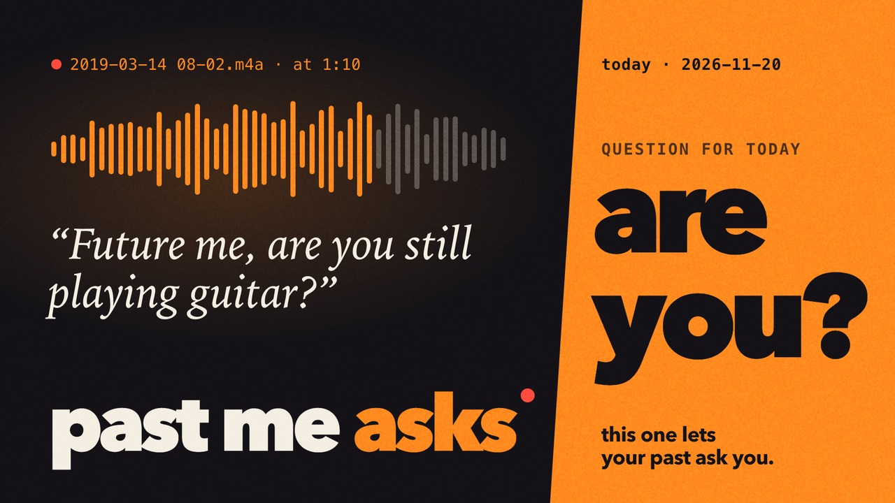

# Past Me Asks

*Most archive tools let you ask your past. This one lets your past ask you.*

A UGOS AI NAS Skill for the [UGREEN Hackathon 2026](https://ugreenhackathon.devpost.com/). It finds the dated, verbatim questions, predictions and promises you once recorded, presents them to you today, and lets you answer with a "Now Me" memo. The AI never judges.

**Track:** Understand Your Life (Bring Memories to Life)  
**Team:** Mert Toprak, Daghan Leflef

## How it works

The Skill reads only the folders you name. It has three modes:

| Mode | What you might say | What you get |
|---|---|---|
| **Past Me Asks** (main) | "What did past me expect from 2026?" | Up to 10 dated, exact quotes aimed at the future, today's answers, and any marks you choose, saved as one dialogue file |
| **Ask Past Me** | "What did I think about moving to Berlin?" | A dated timeline of exact quotes that answer the question, plus an optional "Now Me" answer, saved as one answer file |
| **Build library** | "Transcribe my memos for Past Me Asks" | Memos transcribed and saved as a tagged library file, so later questions do not transcribe them again |

Nothing is written until you approve it. There are three confirmation points:

1. **C1 · The plan** — mode, folders, what was found, the period, a limit of 40 new transcriptions, memo language and speakers, and a data-handling note. You can change the plan or stop.
2. **C2 · The questions or the timeline** — the dated quotes (or the timeline in Ask Past Me). You can answer by typing or by naming a new memo, mark a prediction or promise as kept, not kept or still open, remove a quote, or stop.
3. **C3 · The writes** — the final text and file names. You approve each write separately, all of them, or none. The platform may also ask for its own approval of a write.

### UGOS capabilities

The Skill delegates to registered UGOS experts. It uses only these catalogued actions (UGREEN capability catalog 2.0.0):

- `ug-filesystem` (`file-agent`): `find`, `stat` — list files, dates and name collisions
- `ug-knowledge` (`knowledge-agent`): `audio-transcription` — transcribe memos and any new "Now Me" memo; `collect-evidence` — read notes and existing library files; `save-text` — write approved files

## Privacy and safety

- The Skill reads only the folders you name. It never changes, moves or deletes a memo or note.
- After approval, it writes only new Markdown files whose names start with `past-me-` in the output folder. It does not overwrite existing files.
- The Skill itself sends nothing outside the NAS. Where UGOS runs its transcription and evidence models (on the device or in the cloud) is not documented in the capability catalog; the Skill tells you this before anything is read.
- It gives no advice and makes no judgement. Only you may mark a prediction or promise as kept, not kept or still open.
- Its own outputs are never treated as sources or quoted as "past me".
- Passages with other people's private details (health, money, addresses or numbers) are left out unless you ask for them.

## Repository

```
past-me-asks/                 Skill package for official submission
  SKILL.md
  references/
    quote-rules.md
    report-format.md
    use-cases.md
    test-cases.md
docs/
  Past-Me-Asks_Proposal.pdf   Round 1 proposal (the 10 official questions)
README.md
```

## Status

This is a Round 1 submission: a Skill package (`SKILL.md` and four reference files) plus the proposal PDF. It has not yet been validated on a real UGREEN NAS. If the project is selected as a finalist, it will be tested in the official test environment.

## Development

Created with Codex using the official UGOS Skill Creation Tool (uliya-skill-kit 0.7.3) and checked with its bundled checker.

## Concept video

[](https://www.youtube.com/watch?v=Fa5hfv95OqY)

[Watch the concept video on YouTube](https://www.youtube.com/watch?v=Fa5hfv95OqY) — concept animation, not a device recording.

License: TBD
