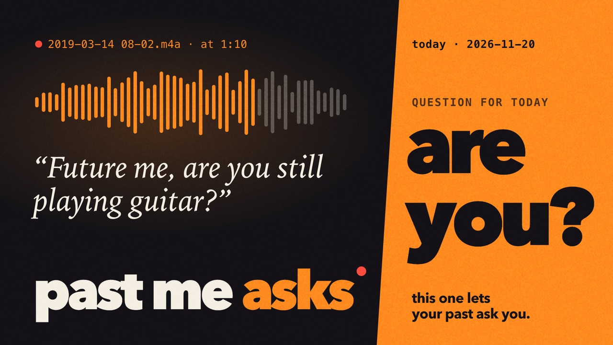

# Past Me Asks: concept video

[](https://www.youtube.com/watch?v=Fa5hfv95OqY)

**Watch on YouTube:** https://www.youtube.com/watch?v=Fa5hfv95OqY

2:57, 1920×1080, 30 fps, English narration. This is a concept animation, not a recording of the Skill running on a NAS.

## Files

```
media/
  past-me-asks-thumbnail.jpg     YouTube thumbnail (16:9)
  past-me-asks-gallery-3x2.jpg   Gallery image (3:2)
  past-me-asks-story.srt         English captions
source/
  narrate.py                     Narration script and voice synthesis; writes the timeline
  retime.py                      Tightens pauses without re-voicing; shifts the timeline to match
  music.py                       Original score, synthesised and mixed under the voice
  index.html                     The animation, driven frame by frame by the timeline
  timeline.js, timeline.json     The timeline used for the published video
  render.mjs                     Captures frames of an HTML page in headless Chrome
  mux.swift                      Encodes the frames and the audio into an MP4
  thumbnail.html                 Layout of the thumbnail
  thumbnail-3x2.html             Layout of the gallery image
```

The MP4 itself is not in the repository (it is larger than GitHub's 100 MB file limit). The YouTube upload is the published version.

## How it was made

Every frame and every sound is generated by the code in `source/`. There is no stock footage, no sampled audio and no outside image.

- **Story:** the narration text in `narrate.py` is based only on this repository: `SKILL.md`, the reference files and the proposal. The people and memos in the video are made-up examples.
- **Voice:** [Kokoro-82M](https://huggingface.co/hexgrad/Kokoro-82M) text-to-speech (Apache-2.0), voice `af_heart`. Names and product terms have explicit pronunciations in the script.
- **Music:** soft piano, a warm pad and a heartbeat pulse, synthesised in `music.py` at 80 BPM. Scene starts snap to the same beat grid, and the music ducks under the voice.
- **Picture:** `index.html` is an HTML/CSS animation. `render.mjs` renders it one frame at a time in headless Chrome. It uses system fonts only (Avenir Next, Helvetica Neue).
- **Encoding:** `mux.swift` writes H.264 video and AAC audio with AVFoundation.

## Rebuilding

Requirements: macOS (for AVFoundation, and `render.mjs` expects Google Chrome in `/Applications`), Python 3 with `kokoro`, `numpy`, `scipy` and `soundfile`, Node.js 22 or later, and Swift (Xcode command line tools).

```sh
cd video/source
python3 narrate.py build/raw                    # voice.wav, timeline.json, timeline.js, captions.srt
python3 retime.py build/raw build/final         # same files, with tighter pauses
cp build/final/timeline.js .                    # index.html loads timeline.js from this folder
python3 music.py build/final/timeline.json build/final/voice.wav build/final/mix.wav
node render.mjs index.html build/frames 30 0 5317
swift mux.swift build/frames 30 build/final/mix.wav build/past-me-asks-story.mp4
```

`render.mjs` renders frames `[from, to)`, so `0 5317` covers the whole 177.2 s at 30 fps. The `timeline.js` already in this folder is the one used for the published video, so `index.html` can be rendered without running the narration step again.
